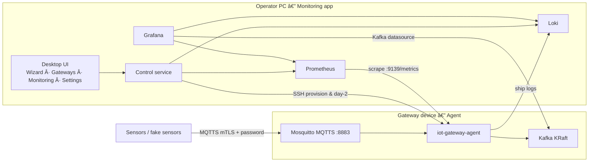
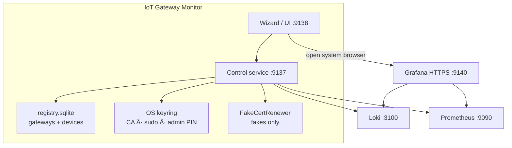
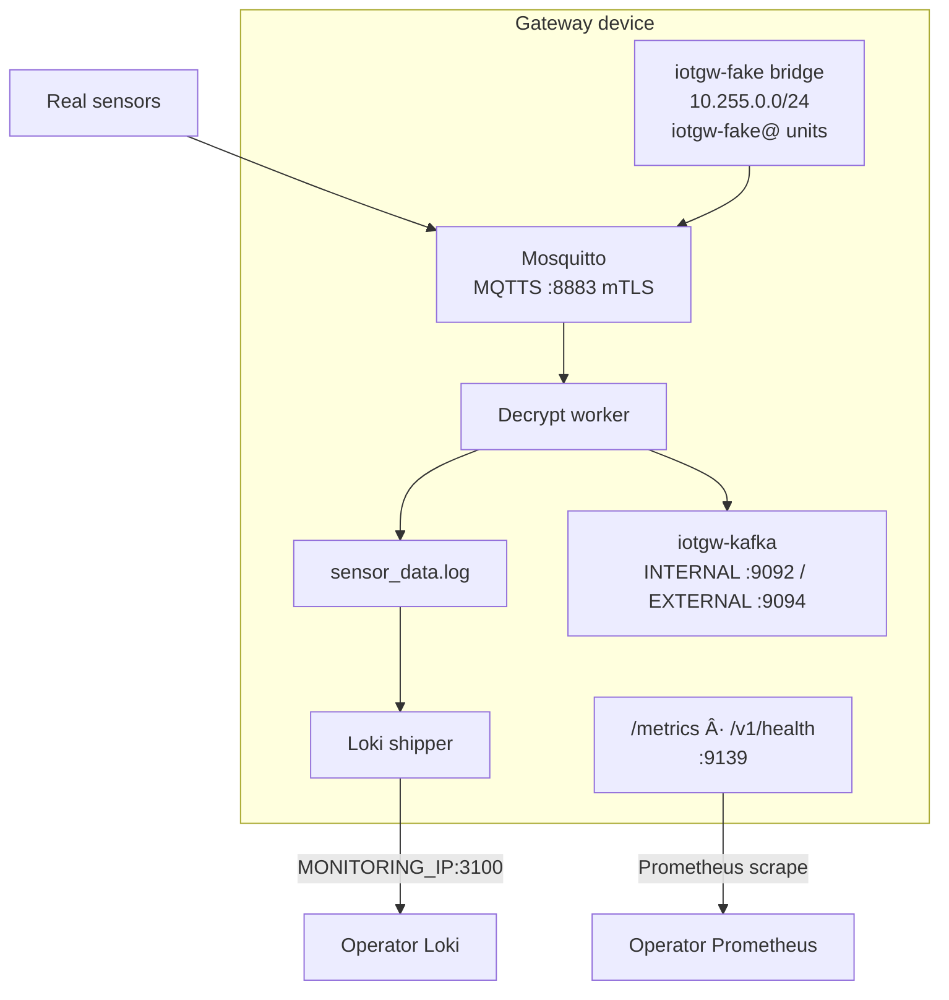
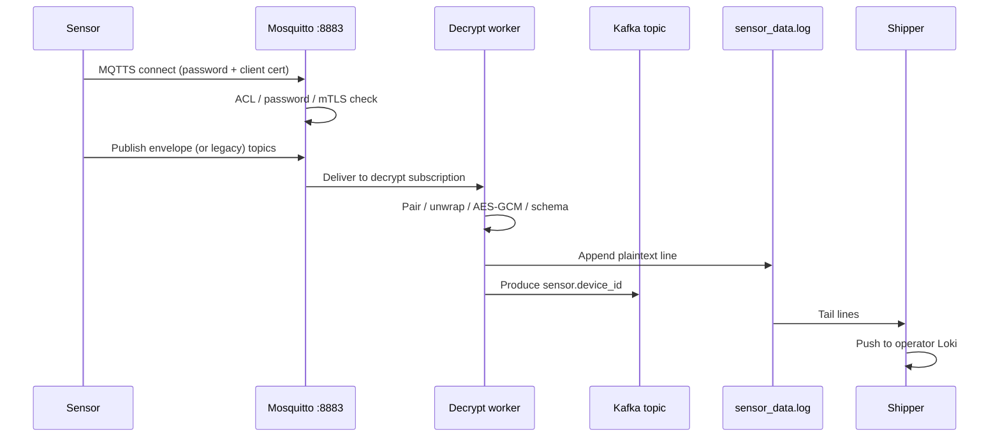
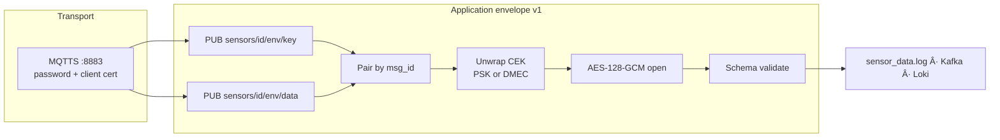
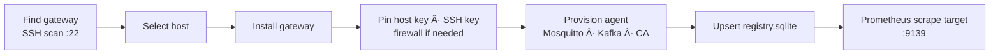
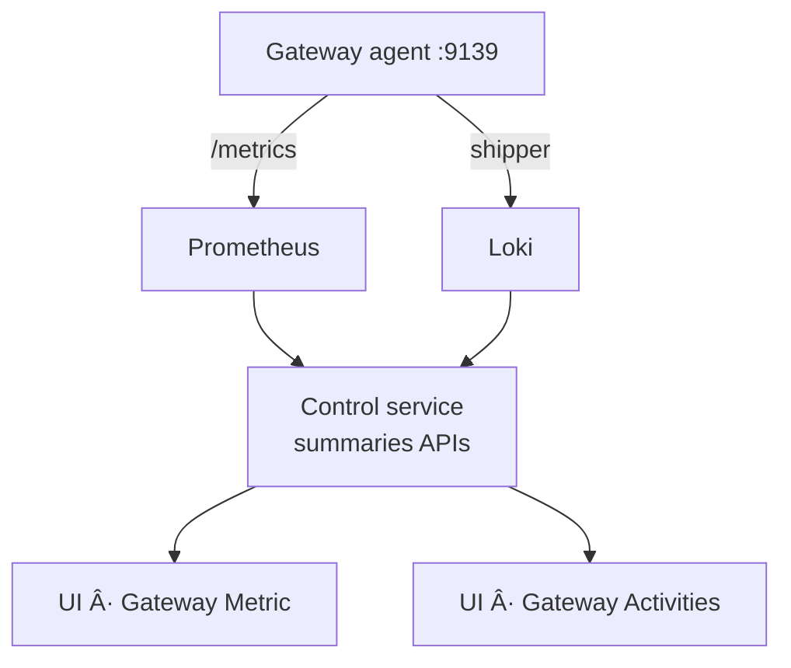
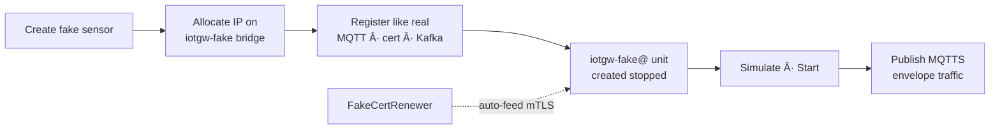

# Architecture

Overview of IoT Gateway Monitor and the gateway agent. Diagrams only — paths, APIs, flags, and formulas live in [`details.md`](details.md). Operator click-paths live in [`UI.md`](UI.md).

## 1. System top level

The system has two applications: the **monitoring app** on the operator PC, and the **gateway agent** on each edge device (for example a Raspberry Pi). Control and provision use SSH. Sensor data uses MQTTS. Metrics and logs flow back to the PC over HTTP.

## 2. Monitoring application

Packaged desktop app (`IoTGatewayMonitor.exe` / AppImage). No Docker and no WSL required on Windows. Loki, Prometheus, and Grafana run as native processes under the app data directory.

| Piece | Role |
|-------|------|
| Wizard / UI | First-run install, Gateways, Monitoring, Control Plane, Settings |
| Control service | Registry, SSH playbooks, query APIs, secret injection |
| Loki / Prometheus / Grafana | Local observability stack (downloaded once in-UI) |
| Keyring | CA passphrase and gateway sudo after Install |

## 3. Gateway application

One systemd agent under `/opt/iot-gateway-agent`, with system Mosquitto and Apache Kafka KRaft beside it. Optional fake sensors share a private bridge on the gateway.

Canonical application order in Metric UI: **Agent → MQTT → Decrypt → Shipper → Kafka**.

## 4. Verification and storage path

A sensor may publish only after registration (MQTT user + ACL + client cert + Kafka topic). The gateway always decrypts so it can validate schema, append the local log, and produce Kafka.

One Kafka topic per registered sensor (`sensor.<device_id>`), size-capped by retention so capacity stays bounded. See [`details.md`](details.md#sensor-capacity-kafka).

## 5. Encryption and decryption overview

Two independent layers: **transport** (MQTTS mTLS) and **application** (envelope v1). Transport answers who may connect. Envelope answers confidentiality of JSON after TLS termination.

Profiles: `v1-psk` (registration wrap secret) and `v1-ecdhe` (ephemeral ECDH + daily DMEC). Legacy Fernet remains accepted until `IOTGW_ENVELOPE_REQUIRE=1`. Full reference: [`details.md` — Encryption](details.md#encryption-envelope-v1).

## 6. Monitoring operations

### 6.1 Spawn and register a gateway

Install bootstraps the gateway CA, server cert, decrypt client cert, Kafka catalog, and stores CA/sudo secrets in the operator keyring for day-2 actions.

### 6.2 Monitor metrics and activities

- **Metric** — host health (CPU, RAM, FS, net, temp) and application up/activity for Agent, MQTT, Decrypt, Shipper, Kafka.
- **Activities** — gateway-wide and per-sensor message counters, Kafka topic metadata, transmission delay, Fake/Real type.

### 6.3 Spawn and register fake sensors

Fakes count toward the same Kafka capacity as real sensors. Gateway uninstall tears down all fake units, netns, and the bridge.

## Related docs

| Doc | Contents |
|-----|----------|
| [`details.md`](details.md) | Ports, paths, APIs, capacity formula, encryption reference |
| [`UI.md`](UI.md) | How to use each tab and feature |
| [`samples/fake-sensor-payload.json`](samples/fake-sensor-payload.json) | Sample manufacturing payload for Simulate |
)
